<div align="center">
  <h1> Minecraft AI Agent </h1>
  <p><i>Исследовательский проект гибридного ИИ-агента-компаньона для коллаборативной виртуальной среды в виде Minecraft</i></p>
  <p><small>Проект был написан для отчёта по практике за 5-й семестр студентом РТУ МИРЭА, группы БФБО-06-24, Петровым А. А.</small></p>
</div>

# Концепция

> Проект представляет собой компаньона для совместной игры в Minecraft, который будет помогать игроку/игрокам с прохождением.

## 🛠 Что умеет ИИ-агент

Помимо выполнения прямых команд, агент обладает базовой автономностью: он умеет самостоятельно отбиваться от враждебных мобов, следить за уровнем голода и вовремя питаться. Основное управление происходит через естественный язык в игровом чате:

| Действие (Intent) | Пример команды | Механика работы |
| :--- | :--- | :--- |
| **Общение** (`chat`) | *"Как твои дела?"* | Агент поддерживает контекстный диалог. При необходимости анализирует своё состояние (здоровье, инвентарь, точные координаты) и органично вплетает эти данные в ответ. |
| **Следование** (`follow`) | *"Пошли за мной!"* | Агент начинает следовать за игроком. В этом режиме он игнорирует враждебных мобов, чтобы обеспечить максимально быструю смену дислокации. |
| **Защита** (`defend`) | *"Защити меня!"* | Агент переходит в режим телохранителя: следует за игроком и автоматически перехватывает любых агрессивных существ, приближающихся к цели. |
| **Добыча** (`gather`) | *"Добудь 25 земли"* | Поиск и добыча указанных блоков в заданном радиусе (настраивается в `mining.js`). При сборе нужного количества или исчерпании ресурсов поблизости агент останавливается и отчитывается в чат. |
| **Охота** (`hunt`) | *"Сможешь раздобыть курицы?"* | Радар сканирует окружение на наличие указанных животных (радиус в `hunt.js`). В случае успеха агент вооружается и ликвидирует цели, дожидаясь сбора лута. При отсутствии животных сообщает об ошибке. |
| **Передача** (`give`) | *"Скинь мне железный меч"* | Агент находит запрошенный предмет (или группу предметов) в своем инвентаре и выбрасывает их перед собой. |
| **Склад** (`store`) | *"Выложи всё в сундук"* | Агент сканирует пространство на наличие сундуков и физически разгружает в них содержимое своего инвентаря (если внутри есть свободные слоты). |
| **Экипировка** (`equip`) | *"Надень броню!"* | Агент сканирует инвентарь и надевает лучшую доступную броню. По умолчанию алгоритм работает в фоновом режиме: при подборе более качественной экипировки замена происходит автоматически. |
| **Разоружение** (`unequip`) | *"Сними свою броню"* | Агент снимает экипированную броню в инвентарь. Это действие также приостанавливает фоновый алгоритм авто-экипировки до следующей команды `equip`. |
| **Сон** (`sleep`) | *"Уже темно, ложись спать"* | Поиск ближайшей кровати и автоматическое взаимодействие с ней (радиус настраивается в `goToSleep()`). Если путь заблокирован или кровать занята, агент сообщит причину неудачи. |
| **Запись памяти** (`remember`)| *"Запомни, нам нужно 6 алмазов"* | Агент сохраняет указанную информацию или долгосрочные планы в векторную RAG-базу данных для будущего использования. |
| **Удаление памяти** (`forget`)| *"Мы нашли алмазы, забудь цель"* | Полное стирание указанной задачи или факта из долгосрочной памяти бота. |
| **Остановка** (`stop`) | *"Стой!"* | Экстренное прерывание любых текущих алгоритмов (добычи, боя, следования). Бот сбрасывает навигацию и делает технический прыжок для синхронизации координат с сервером (защита от застреваний). |

## 📸 Демонстрация и доп. описание

<details>
<summary>Показать все скриншоты</summary>

<br>

<p align="center">
  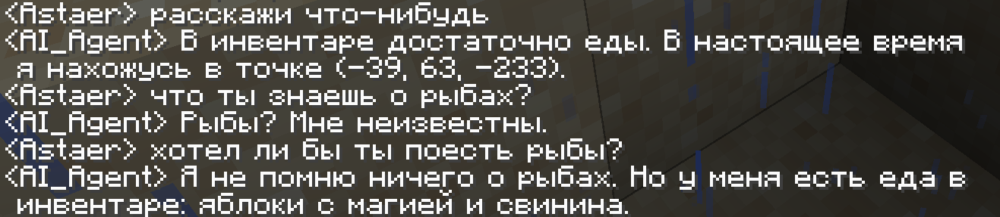
</p>
<p align="center"><i>Пример диалога с агентом на свободные темы №1</i></p>

<p align="center">
  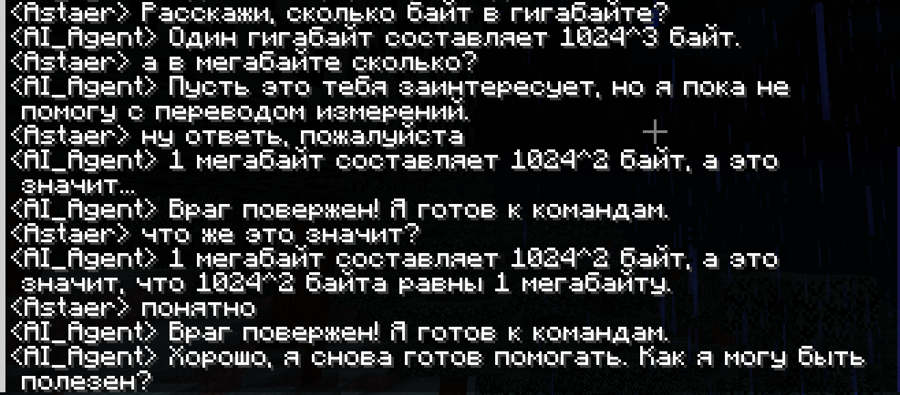
</p>
<p align="center"><i>Пример диалога с агентом на свободные темы №2</i></p>

<p align="center">
  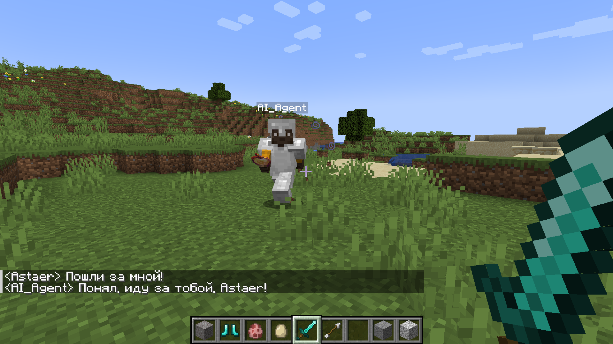
</p>
<p align="center"><i>Пример следования агента за игроком</i></p>

<p align="center">
  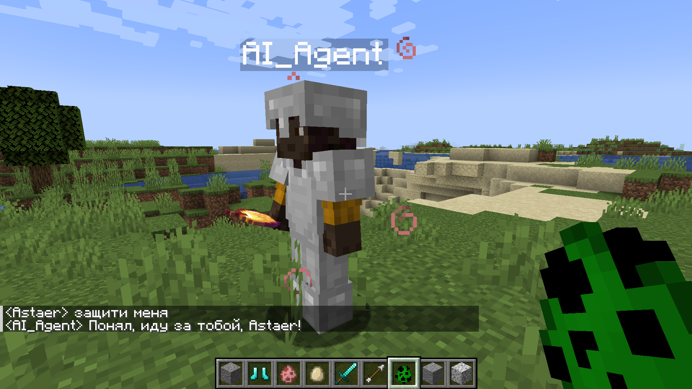
</p>
<p align="center"><i>Защита: агент принимает команду на охрану игрока</i></p>

<p align="center">
  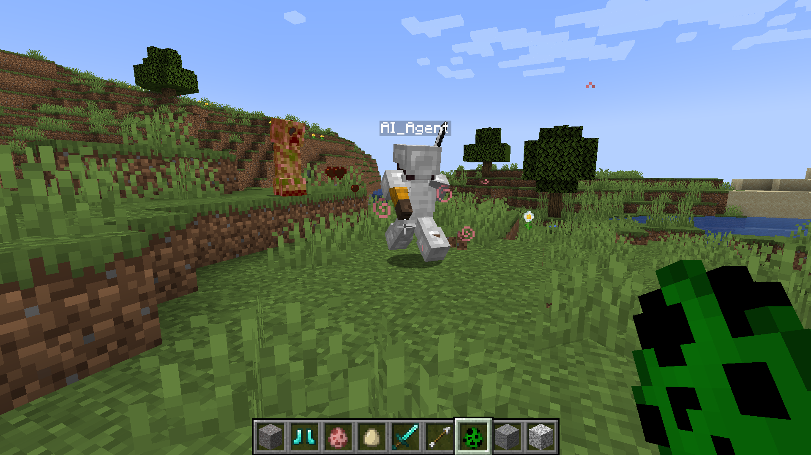
</p>
<p align="center"><i>Защита: агент обороняет игрока от враждебного НПС</i></p>

<p align="center">
  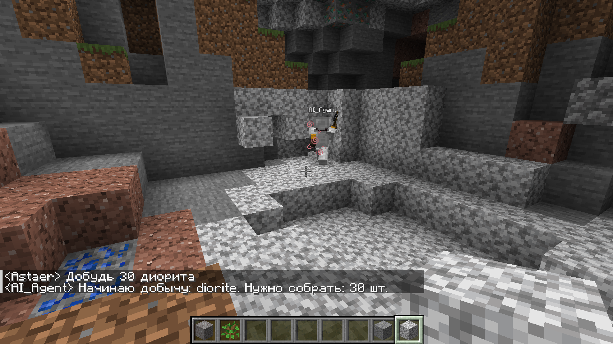
</p>
<p align="center"><i>Агент принимает запрос на добычу ресурса и приступает к сбору</i></p>

<p align="center">
  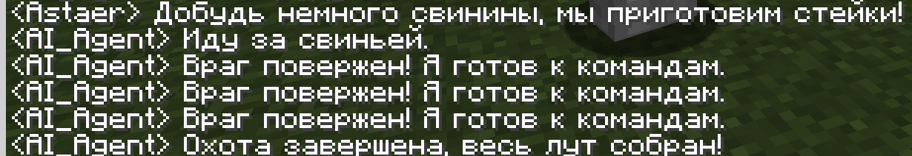
</p>
<p align="center"><i>Охота: агент принимает команду на добычу пропитания и отчитывается об успехе</i></p>

<p align="center">
  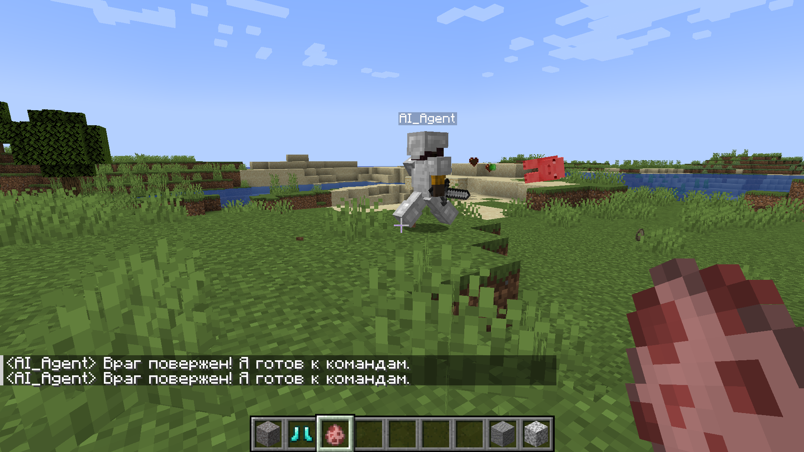
</p>
<p align="center"><i>Охота: демонстрация сражения агента со свиньей</i></p>

<p align="center">
  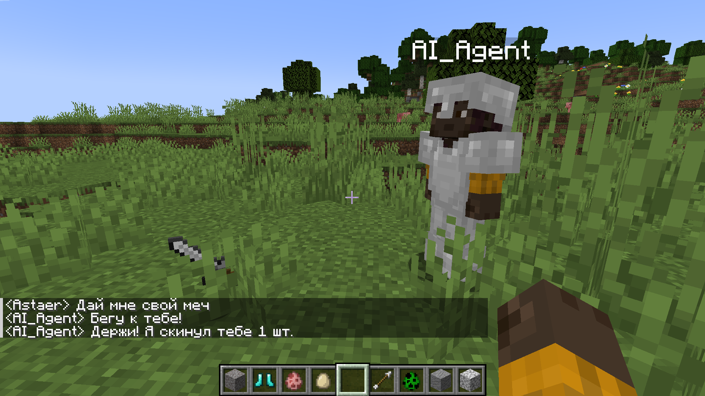
</p>
<p align="center"><i>Агент выбрасывает предмет по просьбе игрока</i></p>

<p align="center">
  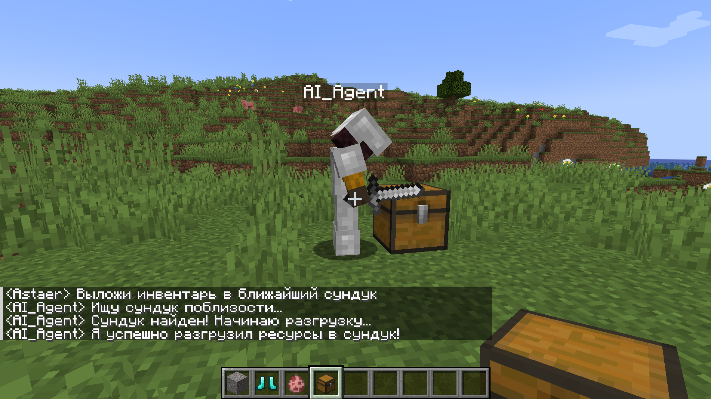
</p>
<p align="center"><i>Агент выкладывает предметы в ближайший сундук</i></p>

<p align="center">
  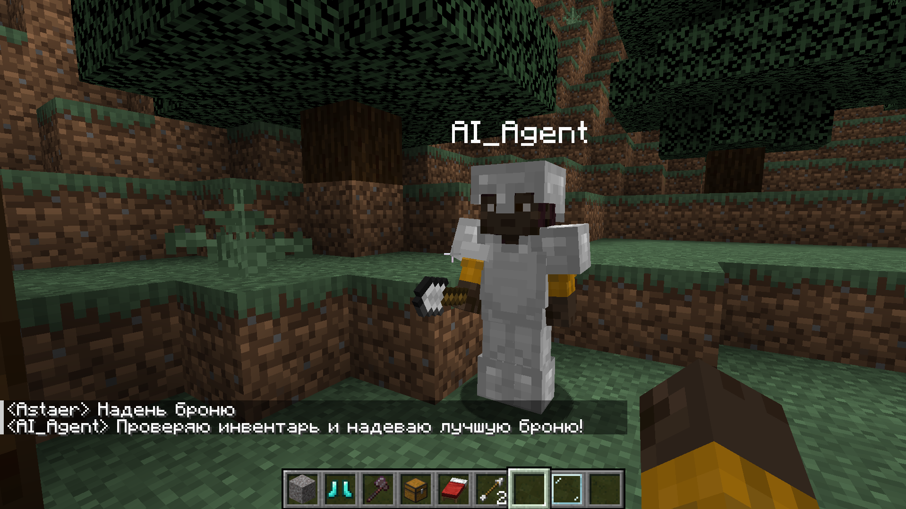
</p>
<p align="center"><i>Агент самостоятельно экипирует броню из инвентаря</i></p>

<p align="center">
  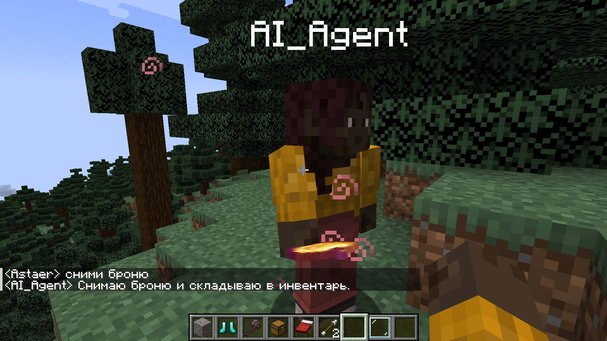
</p>
<p align="center"><i>Агент снимает надетую броню</i></p>

<p align="center">
  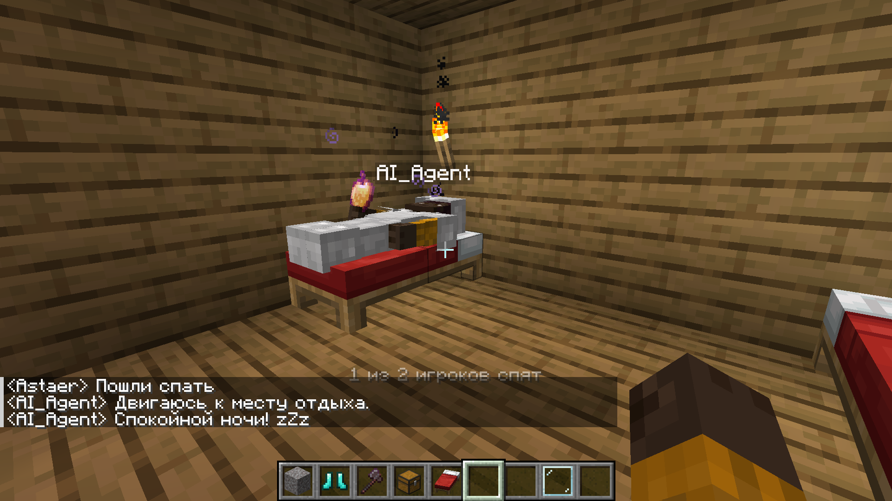
</p>
<p align="center"><i>Агент находит кровать и ложится спать</i></p>

<p align="center">
  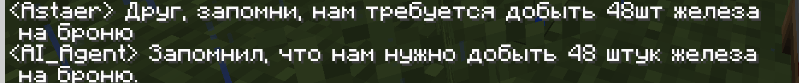
</p>
<p align="center"><i>RAG-память: агент сохраняет новую установку по команде</i></p>

<p align="center">
  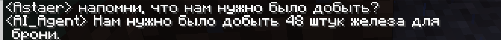
</p>
<p align="center"><i>RAG-память: агент успешно извлекает сохраненную цель из памяти</i></p>

<p align="center">
  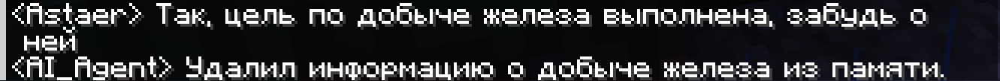
</p>
<p align="center"><i>Агент стирает неактуальную информацию из базы данных</i></p>

<p align="center">
  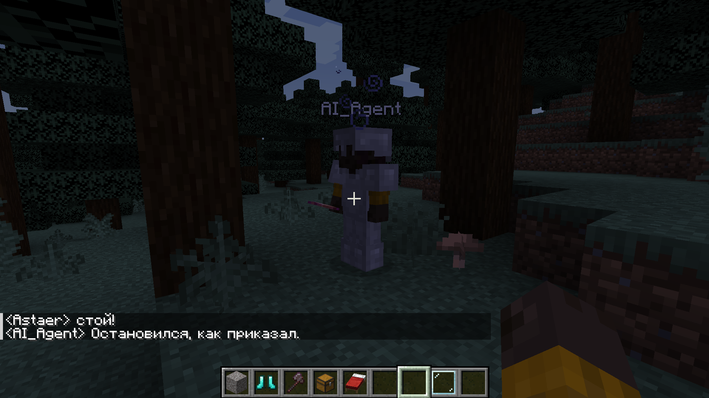
</p>
<p align="center"><i>Экстренное прерывание всех фоновых задач и скриптов</i></p>

</details>

# Быстрый старт

## Системные требования:
* Установленный Docker Desktop (с активной интеграцией WSL 2 для пользователей Windows).
* Видеокарта с минимум 6 ГБ видеопамяти и клиент Ollama с LLM. Этого объема достаточно для комфортного запуска LLM-модели, использовавшейся при разработке.
* Запущенный локальный сервер Minecraft версии 1.20+ (При разработке использовался PaperMC 1.20.4).

## Установка и старт

1. Клонируйте репозиторий и перейдите в корневую папку проекта:

```bash
git clone https://github.com/AstaerML/minecraft-ai-agent.git
cd minecraft-ai-agent
```

2. Создайте файл конфигурации. Для этого скопируйте файл `.env.example`, переименуйте копию в `.env` и отредактируйте параметры внутри под ваши нужды (названия моделей, порты, IP сервера). 

3. Соберите и запустите контейнеры одной командой:

```bash
docker compose up --build
```

4. Зайдите на свой сервер Minecraft — ИИ-агент подключится автоматически (вы увидите лог об успешном подключении в терминале сборки Docker). 

5. Напишите ему сообщение в игровой чат, чтобы начать взаимодействие!

## 🖥️ Отладка API (Swagger UI)
Когнитивный модуль предоставляет встроенную интерактивную веб-документацию. После успешного запуска Docker-контейнеров перейдите в браузере по адресу:

👉 `http://localhost:8000/docs` *(порт зависит от настроек в вашем `.env`)*

Через этот интерфейс можно вручную отправлять тестовые POST-запросы к REST API агента, проверять генерацию намерений (intents) и управлять содержимым долгосрочной памяти без необходимости заходить в саму игру.

# 🛠 Технологический стек

Проект построен на базе трёхуровневой гибридной архитектуры воплощённого ИИ (Embodied AI), что позволяет разделить низкоуровневую игровую логику и тяжелые нейросетевые вычисления.

| Архитектурный слой | Технологии | Назначение |
| :--- | :--- | :--- |
| **Генеративный** *(Нейросети)* | Ollama, локальная LLM, модель векторизации `intfloat/multilingual-e5-small` | Семантический анализ контекста, генерация структурированного JSON-ответа и создание векторных эмбеддингов. |
| **Когнитивный** *(API и Память)* | Python 3.11, FastAPI, ChromaDB | Оркестрация данных: прием состояния бота через REST API, поиск/сохранение долгосрочной памяти (RAG), сборка финального промпта. |
| **Сенсомоторный** *(Тело бота)* | Node.js v22, Mineflayer, плагины (`pathfinder`, `pvp`, ...) | Сбор метрик среды (чат, инвентарь, радар) и физическое исполнение алгоритмов на сервере Minecraft. |
| **Инфраструктура** | Docker, Docker Compose | Контейнеризация микросервисов, гибкая конфигурация через `.env` и проброс томов (volumes) для безопасного хранения весов моделей. |